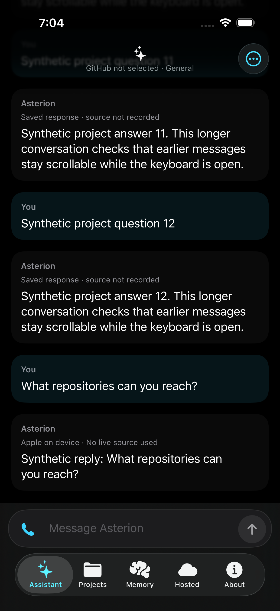
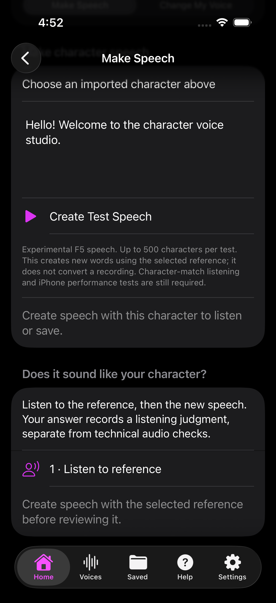
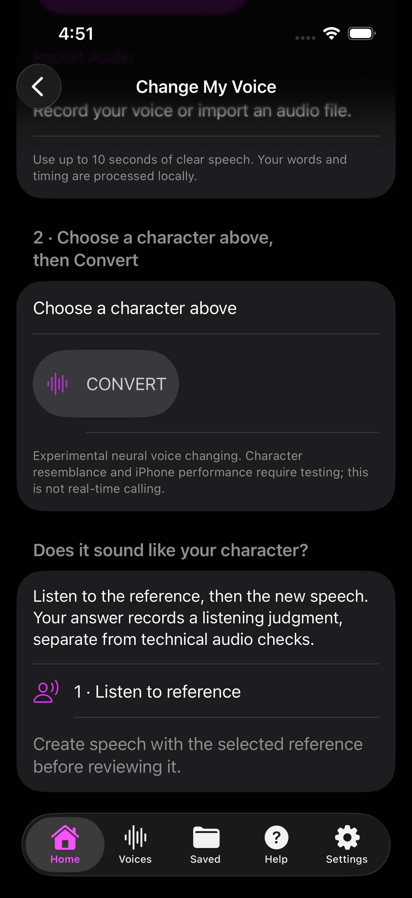

# Chris's Apps

Discover something different. Independent apps, creative tools and experimental projects.

**Add source:** https://raw.githubusercontent.com/R347H4CK3R/OmniForge/main/unified-source.json

[Live refresh logs](https://github.com/R347H4CK3R/OmniForge/actions/workflows/unified-source.yml) · [How this catalog works](README.md)

Physical-device installation and behavior are not certified by this catalog. Unsigned apps need a compatible container or signing. This is not Apple's App Store.

## Explore the collection

| App | Discover | Requires |
| :-- | :-- | :-- |
| [Asterion Veyra](#asterion-veyra) | Personal assistant, voice and desktop pairing | iOS 26.0+ |
| [OmniForge](#omniforge) | Offline AI developer workbench | iOS 17.0+ |
| [VoiceMatrix](#voicematrix) | Offline character speech and voice tools | iOS 26.0+ |
| [Afterlight](#afterlight) | Original survival-game prototype | iOS 17.0+ |
| [Zombies iOS File Tools](#zombies-ios-file-tools) | Game-file scanner and runtime research | iOS 17.0+ |
| [CS2 iOS Runtime Lab](#cs2-ios-runtime-lab) | Native graphics and input test shell | iOS 17.0+ |
| [BOZ Compatibility Test](#boz-compatibility-test) | Experimental integrated-input build | iOS 15.0+ |
| [Native Zombies Prototype](#native-zombies-prototype) | Original Metal survival-game prototype | iOS 17.0+ |
| [BO2CS Tactical Prototype](#bo2cs-tactical-prototype) | Original SDL tactical-game prototype | iOS 16.0+ |
| [COD4iOS Diagnostic](#cod4ios-diagnostic) | Experimental runtime diagnostic build | iOS 17.0+ |
| [BO2 iOS CS Runtime](#bo2-ios-cs-runtime) | Experimental native startup/config runtime | iOS 17.0+ |
| [Prism Puzzle](#prism-puzzle) | Seven puzzles. Always offline. | iOS 15.0+ |
| [ScopePilot](#scopepilot) | Offline captured-traffic evidence review | iOS 16.0+ |
| [Luma Preview](#luma-preview) | Offline tools and private iPhone AI | iOS 14.0+ |
| [Orivyn](#orivyn) | Private local AI with free model downloads | iOS 26.0+ |

## Screenshots

Genuine reviewed simulator previews appear with each app. Open an image to inspect the full interface. Development captures may differ from the latest published build.

## Asterion Veyra

<strong>Personal assistant, voice and desktop pairing</strong>

Personal AI assistant with voice, notes and explicitly paired desktop access. Choose a supported response source and pair only the desktop you intend to use. Requires iOS 26 or later and a supported signing/container setup. Published build and automated checks are verified; installation and behavior on your physical device remain untested by this catalog.

- Version: 0.3.6 · Build: 44
- Requires iOS 26.0 or later · Download: 2.97 MB
- Bundle ID: dev.asterionveyra.assistant

<a href="https://github.com/R347H4CK3R/GhostAI/releases/download/ios-build-44/AsterionVeyra-unsigned.ipa">Download published IPA</a>

Release notes

A personal AI assistant with voice, notes, and explicitly paired desktop access. Requires iOS 26 or later.

Screenshots are reviewed simulator previews, not proof of physical-device behavior.

---

## OmniForge

<strong>Offline AI developer workbench</strong>

Import local GGUF models, inspect IPA files and work with development projects. Models are supplied separately. Unsigned iOS guest app for a configured LiveContainer or a supported signing method. Minimum iOS 17. Release packaging has been inspected; this catalog does not certify physical-device operation.

- Version: 1.1.59 · Build: 159
- Requires iOS 17.0 or later · Download: 4.44 MB
- Bundle ID: com.r347h4ck3r.omniforge

<a href="https://github.com/R347H4CK3R/OmniForge/releases/download/lc-159/OmniForge-LiveContainer.ipa">Download published IPA</a>

Release notes

LiveContainer update 159

**Preview coming soon** · No reviewed screenshot available yet.

---

## VoiceMatrix

<strong>Offline character speech and voice tools</strong>

Build 3 corrects reference/preview pairing and keeps word-check-failed previews out of the current result while preserving diagnostic audio. Standalone local-studio test: bundled speaker analysis, transcription, reference-conditioned previews, automatic reference-profile import and retained live logs. No laptop required for this path. Actual Apple Silicon pipeline and iOS simulator tests passed; physical iPhone behavior, character identity/likeness, broad video-site support and RVC training remain unverified. Not finished 1.0.0. Existing voices and sources retained. Requires iOS 26.

- Version: 0.4.9 · Build: 3
- Requires iOS 26.0 or later · Download: 1305.72 MB
- Bundle ID: com.voicematrix.app

<a href="https://github.com/R347H4CK3R/Ghostline/releases/download/voicematrix-v0.4.9-build3/VoiceMatrix-0.4.9-build3.ipa">Download published IPA</a>

Release notes

Preview/reference pairing correction; failed word-check previews stay unpublished. Standalone local-studio test: bundled speaker analysis, transcription, reference preview, automatic import and retained live logs. No laptop required for this path. Tested with synthetic neutral speech on Apple Silicon and iOS simulator; physical iPhone behavior, character likeness, broad video-site support and RVC training remain unverified. Not finished 1.0.0. Existing voices and source media retained.

Screenshots are reviewed simulator previews, not proof of physical-device behavior.

---

## Afterlight

<strong>Original survival-game prototype</strong>

Original procedural survival-game prototype, separate from Call of Duty. Contains no BO2 assets or third-party game engine in this published version. Simulation and simulator smoke checks are reported as passed; physical-device play remains unverified. Unsigned IPA requires LiveContainer or signing. iOS 17+. Owner avatar is shown because this prototype has no bundled app icon.

- Version: 0.1.0 · Build: 1
- Requires iOS 17.0 or later · Download: 0.10 MB
- Bundle ID: com.r347h4ck3r.nativezombies

<a href="https://github.com/R347H4CK3R/NativeZombies-IOS/releases/download/v0.1.0-prototype/Afterlight-unsigned.ipa">Download published IPA</a>

Release notes

Native ARM64 iOS survival prototype. Simulation and simulator smoke tests passed. Import the unsigned IPA into a configured LiveContainer or sign before installing. Physical-device compatibility remains unverified.

**Preview coming soon** · No reviewed screenshot available yet.

---

## Zombies iOS File Tools

<strong>Game-file scanner and runtime research</strong>

Experimental BO2/PS3 file scanner and importer with native runtime development in progress. Supply your own legally obtained files. This is not verified complete Zombies gameplay. Unsigned automated build; physical-device behavior remains unverified. iOS 17+. Owner avatar is shown because the build has no bundled app icon.

- Version: 1.0 · Build: 3
- Requires iOS 17.0 or later · Download: 0.47 MB
- Bundle ID: com.r347h4ck3r.zombiesios

<a href="https://github.com/R347H4CK3R/Zombies-IOS/releases/download/latest-build/ZombiesIOS-unsigned.ipa">Download published IPA</a>

Release notes

Automated unsigned iOS build from commit 542bccac2f7413a23cb12b95bcee3baa76907dfc. Sign with SideStore/AltStore or your preferred signing method.

**Preview coming soon** · No reviewed screenshot available yet.

---

## CS2 iOS Runtime Lab

<strong>Native graphics and input test shell</strong>

Clean-room native iOS runtime research shell for Metal graphics, audio, controllers, touch and lifecycle logging. This device-test build is not Counter-Strike 2 gameplay and contains no Valve game assets. Requires signing or a compatible container, iOS 17+. Physical-device behavior remains unverified. Owner avatar is shown because no app icon is bundled.

- Version: 0.1 · Build: 1
- Requires iOS 17.0 or later · Download: 0.04 MB
- Bundle ID: com.cs2ios.runtime

<a href="https://github.com/R347H4CK3R/CS2-iOS/releases/download/step3-test/CS2iOS-Step3-unsigned.ipa">Download published IPA</a>

Release notes

Unsigned ARM64 Step 3 device-test build. Sign with your sideloading method before installation.

**Preview coming soon** · No reviewed screenshot available yet.

---

## BOZ Compatibility Test

<strong>Experimental integrated-input build</strong>

Experimental unsigned compatibility update for an existing COD: Black Ops Zombies installation in Strata. Includes integrated manual touch controls; physical-device input feel and session stability remain unverified. This release retains third-party game engine/content and is not an original engine reconstruction; redistribution rights are not certified by this catalog. Read the release INSTALL.md before updating and preserve the existing data container. The listed iOS requirement includes embedded-library minimums, not only the app plist.

- Version: 1.3.5 · Build: 135.20
- Requires iOS 15.0 or later · Download: 378.30 MB
- Bundle ID: com.activision.callofduty.blackopszombies

<a href="https://github.com/R347H4CK3R/BOZ-Strata-Source/releases/download/integrated-input-v1/BOZ-Integrated-Input-unsigned.ipa">Download published IPA</a>

Release notes

Integrated-input compatibility test build. Native ARM64 input checks are reported by the release. Existing engine and content are retained. Follow the published installation guide for the existing Strata setup; no new maps or weapons. Device behavior remains unverified.

**Preview coming soon** · No reviewed screenshot available yet.

---

## Native Zombies Prototype

<strong>Original Metal survival-game prototype</strong>

Experimental original native survival-game prototype with procedural visuals, waves, weapons, touch/controller input and developer controls. Separate from Afterlight and not an Activision game. The reviewed source build passed 20 simulator unit tests and an ARM64 device build; physical-device gameplay and SideStore installation remain untested. Unsigned IPA requires compatible signing. iOS 17+. Owner avatar is used because no reviewed app screenshot or bundled icon is available.

- Version: 1.0 · Build: 1
- Requires iOS 17.0 or later · Download: 0.15 MB
- Bundle ID: com.nativezombies.game

<a href="https://github.com/R347H4CK3R/-Native-Zombies-iOS/releases/download/prototype-1.0-build1/NativeZombies-unsigned.ipa">Download published IPA</a>

Release notes

Original Native Zombies prototype, version 1.0 (1), for iOS 17 or later.

A small native Metal survival-game prototype with procedural visuals, rounds, weapons, touch/controller input and developer controls. This is an experimental development build, not an Activision game or a finished commercial title.

This unchanged unsigned IPA comes from source commit 1874b504502d00a2b120e15de1fd8e4a2cd374dd and successful build https://github.com/R347H4CK3R/-Native-Zombies-iOS/actions/runs/36511217716 . That run passed 20 simulator unit tests and an ARM64 device build. Separate archive checks verified the app identity, version, device platform and minimum OS. Physical-device gameplay and SideStore installation have not been tested.

Sign with a compatible sideloading tool before installation. Keep save backups; do not confuse this app with Afterlight, which has a different bundle identifier. No proprietary game assets are included by this project&#x27;s build.

SHA-256: 249ea989a36898129a5edec08ba9d4c094b44b7e5ea0f469e44b7ef57f554c28

**Preview coming soon** · No reviewed screenshot available yet.

---

## BO2CS Tactical Prototype

<strong>Original SDL tactical-game prototype</strong>

Original MIT-licensed tactical FPS prototype using SDL2 and original validation fixtures. Not a Call of Duty game or a complete commercial-game port. Native compile, archive validation and the recorded simulator gameplay autotest passed. Physical-device gameplay and SideStore installation remain untested. Unsigned IPA requires compatible signing, iOS 16+. Owner avatar is shown because no reviewed app icon or screenshot is available.

- Version: 0.1.0 · Build: 1
- Requires iOS 16.0 or later · Download: 0.52 MB
- Bundle ID: io.github.r347h4ck3r.bo2cs

<a href="https://github.com/R347H4CK3R/BO2CS/releases/download/prototype-0.1.0-build1/GameName-unsigned.ipa">Download published IPA</a>

Release notes

BO2CS Tactical Prototype 0.1.0 (1), iOS 16 or later. Original MIT-licensed tactical FPS prototype using SDL2, not a Call of Duty game and not a complete commercial-game port. Uses original validation fixtures; no proprietary game data is required.

Exact source: https://github.com/R347H4CK3R/BO2CS/tree/0a00baf09cf89697e3c5341a76800c5dbcb7cd3f . The source pins SDL and JSON dependencies; their notices are bundled in the IPA. Project MIT license accompanies this release.

Build https://github.com/R347H4CK3R/BO2CS/actions/runs/35542001636 passed native compilation, IPA validation and simulator gameplay autotest. The actual simulator receipt reports PASS and passed=true. The device IPA was not executed, and physical-device gameplay/SideStore installation are untested. Unsigned IPA requires compatible signing. Keep existing saves backed up.

The IPA is unchanged from reviewed artifact 10614504342,522884 bytes. SHA256: 2a1a19d9692be8e163c0a2b3a38f3c96c41e2e10251b30ef53e14e76b3836838.

**Preview coming soon** · No reviewed screenshot available yet.

---

## COD4iOS Diagnostic

<strong>Experimental runtime diagnostic build</strong>

Experimental COD4iOS diagnostic build, not verified complete campaign or multiplayer behavior. Public package excludes retail game data and signing profiles; supply your own legally obtained compatible original PC game files. Includes third-party notices and an exact matching-source archive in the release. ARM64 archive structure and hashes are verified; physical-device gameplay and SideStore installation are untested. Requires compatible signing and iOS 17+. Back up existing saves. Owner avatar is used pending reviewed artwork.

- Version: 1.0.3 · Build: 4
- Requires iOS 17.0 or later · Download: 9.57 MB
- Bundle ID: com.devz.cod4ios

<a href="https://github.com/R347H4CK3R/COD4iOS-COD4NS/releases/download/diagnostic-1.0.3-build4/COD4iOS-playtest-unsigned.ipa">Download published IPA</a>

Release notes

COD4iOS diagnostic 1.0.3 (4), iOS 17 or later. Experimental development build, not a promise of complete campaign/multiplayer compatibility or physical-device stability.

This exact unsigned IPA was built at commit 241f76173741a4c39b2d0abb9e69b7ccc6dbfd96 in https://github.com/R347H4CK3R/COD4iOS-COD4NS/actions/runs/38847728229 . Its public packager excludes retail game data and signing profiles, includes third-party license notices, and validates the archive. Independent inspection verified app identity, ARM64 device platform, minimum OS and SHA256. The app was not run on a physical iPhone in this review.

The matching source archive is included, recreated byte-for-byte against the original build receipt, including the matching OpenAL source and build scripts. Read its GPL and third-party licenses. Retail game files are not included; supply your own legally obtained compatible files. Sign the IPA with a compatible sideloading tool; preserve saves and existing data before changing installations.

**Preview coming soon** · No reviewed screenshot available yet.

---

## BO2 iOS CS Runtime

<strong>Experimental native startup/config runtime</strong>

Experimental Xash-based iOS runtime using safe normalized fixtures. Native startup and generated-config execution are verified; full converted BO2 gameplay, campaign and multiplayer are not present. This is not a finished commercial-game port. Includes Xash GPL, HLSDK and SDL notices, with complete matching patched source and pinned dependencies in the release. Corrected logging verified the exact existing simulator candidate without changing its binary. Physical-device gameplay and SideStore installation remain untested. Unsigned IPA needs compatible signing, iOS 17+. Owner avatar is used pending reviewed artwork.

- Version: 0.1 · Build: 3
- Requires iOS 17.0 or later · Download: 5.57 MB
- Bundle ID: com.r347h4ck3r.bo2ioscs.xash

<a href="https://github.com/R347H4CK3R/BO2-IOS-CS/releases/download/runtime-0.1-build3/BO2IOSCS-Xash-integrated.ipa">Download published IPA</a>

Release notes

BO2 iOS CS experimental Xash runtime 0.1 (3), iOS 17 or later. This is a native startup/runtime research build using safe normalized fixtures, not full converted BO2 gameplay or a complete commercial-game port. Physical-device gameplay and SideStore installation have not been tested.

The exact unsigned IPA comes from verified source commit 19b855bd032587eed6f2f972b1019997a8c72b89 and build https://github.com/R347H4CK3R/BO2-IOS-CS/actions/runs/42521767991 . Native compilation, unit tests and archive checks passed. The first startup check missed an early log line. After fixing log capture without changing the app or pass criteria, startup/config execution was verified using the exact existing simulator artifact: https://github.com/R347H4CK3R/BO2-IOS-CS/actions/runs/42523257291 . Independent inspection verified the ARM64 device payload, bundle/version, OS requirement and embedded legal notices.

Required Xash GPL, HLSDK and SDL license texts are included in the app. The accompanying corresponding-source archive contains 9,203 tracked source files, initialized pinned dependencies, applied patches, original notices and build scripts, with a per-file hash manifest. GPL-covered code and upstream notices retain their licenses. The HLSDK components are distributed free of charge. No proprietary PS3 source dumps or retail game files are included.

Sign the unsigned IPA using a compatible sideloading tool. Preserve existing saves/data. Read the source README and build scripts for the project&#x27;s current limitations; this release does not prove complete game conversion, campaign or multiplayer support.

**Preview coming soon** · No reviewed screenshot available yet.

---

## Prism Puzzle

<strong>Seven puzzles. Always offline.</strong>

Seven offline puzzles, local progress and unlimited free hints. Includes an offline improvement-draft composer with review and manual-copy fallback to the explicitly named private repository; authorized GitHub access is required outside the app. No uploads, accounts, ads or network service in the app. Build 6 corrects cube-edge occlusion in three settled native simulator captures. Native interaction, persistence and suggestion checks passed. Desktop Playwright WebKit screenshots still flatten the cube. Unsigned iOS 15+ prerelease needs compatible signing. Physical-device gameplay, signed upgrades and Strata installation remain unverified.

- Version: 1.1.3 · Build: 6
- Requires iOS 15.0 or later · Download: 0.06 MB
- Bundle ID: com.prismpuzzle.app

<a href="https://github.com/R347H4CK3R/OmniForge/releases/download/prism-puzzle-1.1.3-build6/Prism-Puzzle-unsigned.ipa">Download published IPA</a>

Release notes

# Prism Puzzle 1.1.3 (build 6) prerelease

Corrects the cube&#x27;s intermittent black edge strip by removing redundant outward core planes behind the colored stickers. All three settled native simulator captures now show complete visible cube faces. Seven offline games, local progress and unlimited hints remain available. The existing com.prismpuzzle.app identity is preserved.

The offline suggestion composer lets you review a draft and select it for manual copying to the explicitly named private R347H4CK3R/Prism-Puzzle repository using your own authorized GitHub account outside the app. It does not upload suggestions, open external pages, alter the OS clipboard, include puzzle saves, persist drafts or store credentials. A separate owner-authorized daily review is configured; no completed scheduled run is claimed. The app is not an autonomous coding agent. Untrusted suggestions cannot authorize sensitive actions, deletion or publication. The private source includes a tested fail-closed review/release evidence contract; a 30-day target is not a guaranteed release.

## Verification
The exact candidate passed 80 Node tests, fail-closed IPA-validator regression, generated-asset equality, Chromium real-touch and offline local-file cold-load checks, WebKit mouse-pointer and in-session offline checks, and both engines&#x27; feedback privacy, review, selection, revocation, save-preservation and 390px layout checks. All four native iOS 26.2 simulator tests passed with zero failures in 572.013 seconds, covering stable cube visual diagnostics, cube touch, all seven puzzles, unlimited hints, persistence and suggestion review/selection. Unsigned arm64 iOS device compilation and independent IPA identity, platform and bundled-byte checks passed. All 69 files in the private source archive match the tested commit.

## Limits
The cube correction is verified in settled simulator captures, not every angle or mid-animation frame. Desktop Playwright WebKit screenshots still flatten the cube despite passing interaction checks; native simulator captures show full 3D. Physical iPhone/iPad installation and gameplay, signed upgrades, OS clipboard copy/paste and Strata installation remain untested. This is an unsigned iOS 15+ prerelease requiring compatible signing, not an App Store or production-certified build. Preserve existing saves before changing installations.

Asset-only distribution. The Prism-Puzzle repository and source archive remain private; the IPA includes the web assets needed to run the app. Automatic GitHub source archives refer to OmniForge, not Prism-Puzzle. No private source archive, diagnostic logs, signing keys or personal data are included.

IPA: 62,715 bytes
SHA-256: c60dd3b7ec1b088f6862d26d13de66cc24c8494b220cb559675d61a7d035d3e7

**Preview coming soon** · No reviewed screenshot available yet.

---

## ScopePilot

<strong>Offline captured-traffic evidence review</strong>

Scope-gated offline HAR import with preview/save/discard and sensitive-data filtering, plus user-triggered public-program discovery, official-policy review, local cookie/CORS/HSTS/CSP/cache evidence analysis and redacted report drafts. No autonomous probing, exploits, automatic submissions, guaranteed bounties or confirmed vulnerabilities. 34 core tests, browser/HAR UI tests, iPhone simulator smoke and device compilation passed. Unsigned iOS16+ preview needs compatible signing/container. Physical iPhone/Strata installation, native HAR picker and full device QA remain unverified.

- Version: 0.3.0 · Build: 3
- Requires iOS 16.0 or later · Download: 0.05 MB
- Bundle ID: app.scopepilot.mobile

<a href="https://github.com/R347H4CK3R/OmniForge/releases/download/scopepilot-0.3.0-build3/ScopePilot-unsigned.ipa">Download published IPA</a>

Release notes

# ScopePilot 0.3.0 (3) unsigned iPhone preview

Adds private, offline HAR import for scope-gated review of captured browser traffic. Preview results before saving or discarding; sensitive-data filtering limits retained evidence. Review current official policies and obtain authorization before testing.

Includes user-triggered HackerOne/Bugcrowd public-directory discovery, authorization gates, local cookie/CORS/HSTS/CSP/cache evidence analysis and redacted report drafts. No autonomous probing, exploit execution, automatic submissions, guaranteed bounty or confirmed vulnerabilities.

Verified: 34 core tests, browser/HAR import UI checks, native iPhone simulator install/launch/navigation, unsigned iPhone compilation and IPA integrity/metadata/arm64 inspection. Physical iPhone and Strata installation, native HAR file picker and full feature/device QA remain unverified. Unsigned iOS16+ arm64 package requires compatible signing or a supported configured container. Not an App Store release.

Bundle: app.scopepilot.mobile
Version: 0.3.0 build3
IPA bytes: 53907
SHA-256: 7d8916cab61cbdd882d49ceac02fe9505c10d343e0a446708d79c69b8a25435c
Source commit: 30a3c3a065fe5728e3196c69fdd2a3cd826368e8
Build run: 42628336191

Asset-only distribution; ScopePilot source remains private. Automatic GitHub source archives refer to OmniForge, not ScopePilot. No user traffic captures, credentials or signing keys are included.

**Preview coming soon** · No reviewed screenshot available yet.

---

## Luma Preview

<strong>Offline tools and private iPhone AI</strong>

Local-first assistant with notes, search, seven offline planning kits, six editable prompt starters and setup guidance. Version 1.2 adds native Files import/sharing and optional password-encrypted portable backups. Local app notes and plain backups remain unencrypted. Apple on-device AI requires eligible iOS26 Apple Intelligence hardware and available system model; older iOS14+ devices retain offline tools. Optional compatible server may cost money. No automatic cloud fallback, voice, sync, reminders or autonomous external actions. Unsigned user-signable preview. Unit/browser/native tests and builds passed; physical installation, inference and Files behavior remain unverified.

- Version: 1.2 · Build: 4
- Requires iOS 14.0 or later · Download: 3.32 MB
- Bundle ID: app.luma.personal

<a href="https://github.com/R347H4CK3R/OmniForge/releases/download/luma-preview-1.2-build4/Luma-unsigned.ipa">Download published IPA</a>

Release notes

# Luma 1.2 (build 4)

Unsigned arm64 iPhone preview for user signing with Strata/SideStore. This is not an App Store release or a fully autonomous assistant.

## Included

- Local notes, search and goal checklists.
- Seven offline planning kits, six editable prompt starters and a setup guide, without an account or model download.
- Native iPhone Files backup import and system sharing.
- Optional AES-256-GCM password-encrypted portable backups. Keep the passphrase safe; it cannot be recovered. Local app notes and plain JSON backups remain unencrypted.
- Apple on-device AI on eligible iOS 26 Apple Intelligence devices with an available system model, opt-in bounded memory context and reviewed answer saving. Apple supplies the model through the operating system; no model weights are bundled.

Older iOS 14+ devices retain local tools. Optional user-configured HTTPS model servers receive only submitted content and may charge fees. No automatic cloud fallback, voice, external integrations, sync, reminders or background autonomy are included. Answers never execute actions or save themselves.

Sharing is user-directed through the system sheet. Temporary export files are protected and normally removed after sharing, but may remain temporarily after abrupt termination. Encryption protects only the exported backup, not app-local notes or later decrypted copies.

## Verification and limits

Source commit: 99bb28d4fa20467ccb000fc60281a28a6def9303.

23 JavaScript unit tests, 10 browser tests, native validation tests, actual FoundationModels and unavailable-framework fallback compilation, simulator compilation and unsigned device compilation passed. Browser report upload failed because GitHub Actions artifact storage was full; tests passed.

Physical iPhone installation, real model inference, Files picker/share behavior and accessibility remain unverified. Signing and Apple platform restrictions apply. The local interface requires iOS 14 or later; on-device AI requires supported iOS 26 hardware, enabled Apple Intelligence and available system assets, with language/region restrictions.

Third-party notices are bundled and supplied alongside the release. No credentials, user data or private source code are included.

**Preview coming soon** · No reviewed screenshot available yet.

---

## Orivyn

<strong>Private local AI with free model downloads</strong>

Independent local-first iPhone assistant with nine downloadable model choices, chat history, documents and image text recognition, voice, projects and response preferences. No subscriptions or paid app tiers. Optional remote endpoints are off by default and their providers may charge separately. Unsigned iOS26 preview; SideStore must sign it. Models download separately. Build4 native and UI tests passed, including real default-model download and inference. This catalog does not certify physical-device installation/refresh, voice, offline use, large-model memory or thermal performance. Cross-app text staging, local reminders and external account integrations are not in this build. Not an OpenAI product.

- Version: 0.1.0 · Build: 4
- Requires iOS 26.0 or later · Download: 4.19 MB
- Bundle ID: app.jarvisevo.ios

<a href="https://github.com/R347H4CK3R/Orivyn-Distribution/releases/download/orivyn-v0.1.0-build4/Orivyn-0.1.0-build4-distribution-unsigned.ipa">Download published IPA</a>

Release notes

Build4 development preview. 288 native and27 UI tests passed for the original application payload, including actual default-model download, answer and relaunch. Distribution copy adds only the bundled llama.cpp MIT notice; every original payload entry is byte-identical. Physical-device acceptance remains incomplete. Incoming-text sharing, local reminders and external account integrations are not included.

**Preview coming soon** · No reviewed screenshot available yet.

---

Catalog versions and requirements are generated from inspected public release IPAs. Missing app icons use the repository owner avatar, not invented artwork.
