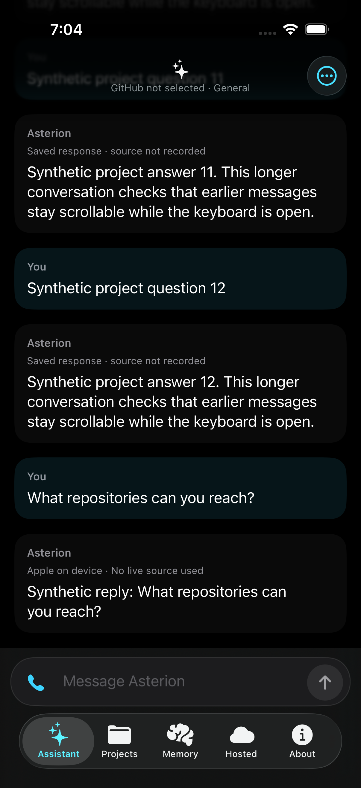
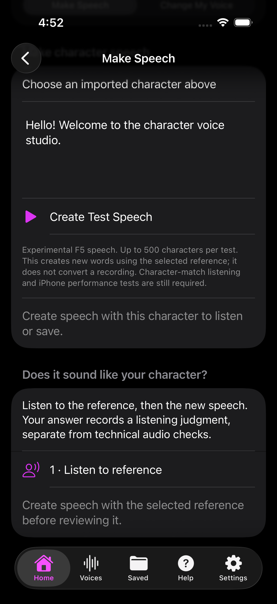
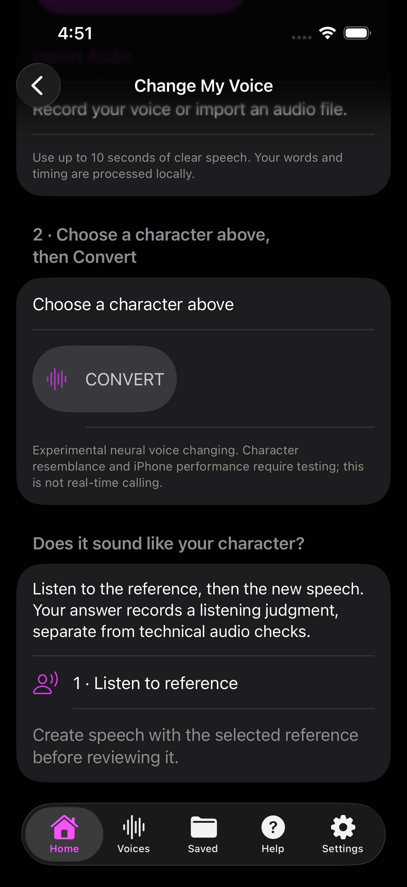

# Chris's Apps

**[Browse apps, versions and screenshots](APPS.md)** · [Live refresh logs](https://github.com/R347H4CK3R/OmniForge/actions/workflows/unified-source.yml)

One source, separately installable apps. Add the catalog URL to a compatible iOS source browser:

https://raw.githubusercontent.com/R347H4CK3R/OmniForge/main/unified-source.json

## OmniForge
**Offline AI developer workbench**

Import local GGUF models, inspect IPA files and work with development projects. Models are supplied separately. Requires iOS 17 or later and a configured LiveContainer or supported signing method. Release packaging is inspected; physical-device operation is not certified by this catalog.

[Original source](../livecontainer-source.json) · [Releases](https://github.com/R347H4CK3R/OmniForge/releases)

## VoiceMatrix
**Offline character speech and voice tools**

Import your own character folders, generate offline speech and convert recordings with local neural engines. No stock characters are bundled. Requires iOS 26. This is an experimental character-test edition: diagnostic speech and simulator conversion checks pass, while physical iPhone behavior and character likeness remain unverified.

[Original source](https://github.com/R347H4CK3R/Ghostline/blob/main/strata-source.json) · [Releases](https://github.com/R347H4CK3R/Ghostline/releases)

## AI assistant / Veyra
Asterion Veyra is included after published IPA verification. Its separate SideStore source is https://raw.githubusercontent.com/R347H4CK3R/GhostAI/sidestore-source/source.json . Keep the existing app and signing account when updating; export important chats and notes first. Physical-device SideStore installation and data retention are not certified by CI.

## Screenshots

Veyra’s chat preview is a real simulator capture from build-37 source commit c517179, using synthetic UI-test conversation text, not personal chats or evidence of real model inference. [Build/test provenance](https://github.com/R347H4CK3R/GhostAI/actions/runs/42511200595).

VoiceMatrix previews below are genuine automated iOS simulator captures of the development UI, using an empty character library and default demonstration text. They illustrate speech and conversion screens, not physical-device performance or an exact release certification. No imported character audio or private conversation is shown.

OmniForge screenshots are not yet available. No screenshots are fabricated.

## Versions, updates and live logs
The catalog lists each app's actual IPA version, build number, minimum iOS, download size and release notes. Icons come from each app's published source. Apps keep their own bundle IDs and data containers. This is a curated source, not Apple's App Store and not a promise that every app supports every installer.

The refresh workflow runs hourly and on registry changes. It validates public release assets, reads actual IPA metadata and checks supported release evidence before changing an entry. A failed update leaves the previous good entry in place. Experimental limitations remain visible.

[Live refresh runs and step logs](https://github.com/R347H4CK3R/OmniForge/actions/workflows/unified-source.yml). Open the newest running workflow to follow its steps. The downloadable verification report lists accepted and skipped entries; no credentials are used to fetch app feeds or binaries.

Other projects are excluded until their public IPA and verification evidence are ready. Android APKs, Windows downloads, private analysis inputs and blank source placeholders never enter this iOS catalog.

## More public app projects

The storefront also includes Afterlight (original survival prototype), Zombies iOS File Tools (file scanner/importer and runtime research), CS2 iOS Runtime Lab (native graphics/input test shell), and BOZ Compatibility Test (already-public third-party game compatibility build, not rehosted here). Their descriptions distinguish prototypes and tools from complete commercial games.

BOZ's effective minimum is iOS 15 because a required embedded input library has a higher deployment target than the app plist. The catalog inspects embedded libraries as well as the main executable. Third-party game redistribution rights are not certified by this catalog; use only content you are entitled to use.

Apps without a genuine bundled icon show the repository owner's avatar. Missing screenshots are not invented. Release-only projects are refreshed directly from an explicit public-release channel, with versions read from the IPA. A changed binary using the same version/build is rejected. Release hosts can replace/delete assets, so retaining a catalog entry cannot restore a remotely deleted binary.

## IPA project pipeline

[See remaining IPA-producing repositories and their publication status](PIPELINE.md). Expiring CI artifacts are not disguised as permanent install links.
